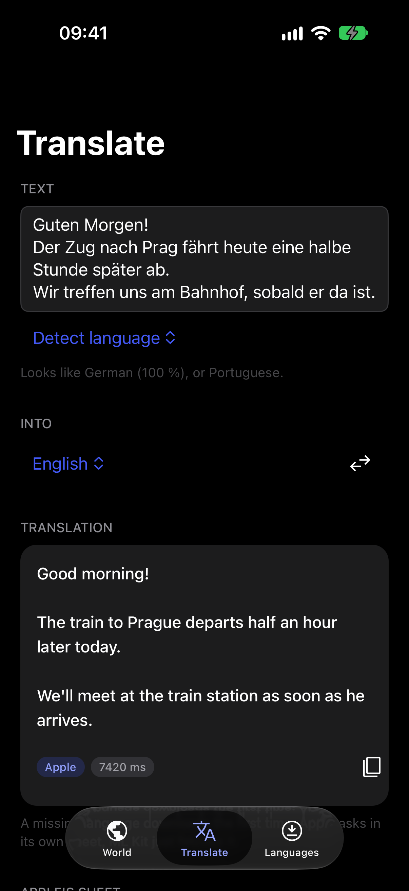
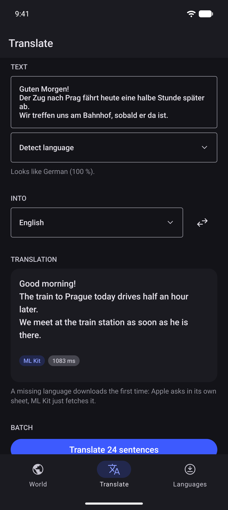

# expo-translation

[](https://www.npmjs.com/package/@hzblj/expo-translation)
[](./LICENSE)

On-device translation for Expo on the platforms' own engines: Apple's Translation framework on iOS (with Google's ML Kit for the languages it lacks, when you turn it on) and ML Kit on Android. Language checks and downloads, language identification, batches that arrive text by text, a cache, hooks and Apple's translation sheet. Nothing is sent anywhere.

<p>
  
  
</p>

```sh
npx expo install @hzblj/expo-translation
```

```tsx
import {Translation, useTranslation} from '@hzblj/expo-translation'

const {text} = await Translation.translateAsync('Der Zug fährt um acht.', {from: 'de', to: 'en'})

// In a list: each row's translation, sent with the rest of the screen as one batch, cached for the next render.
const {text: translated} = useTranslation(message.body, {to: 'en'})
```

**[Documentation](./packages/expo-translation/README.md)**: translating, what makes it fast, every option, languages and downloads, identification, Apple's sheet, errors and how the platforms differ.

## This repository

| Path | What lives there |
| --- | --- |
| `packages/expo-translation/` | `@hzblj/expo-translation`, the published package: the JavaScript API, cache and hooks, the iOS and Android module, and the config plugin |
| `apps/example/` | The example app, built from [Kara](https://github.com/hzblj/kara-ui): fifteen Wikipedias' articles of the day (fetched from Wikimedia while it runs) translated on the device, a playground with identification, Apple's sheet and a timed batch, and the languages with their downloads |

```sh
yarn                 # install
yarn prebuild        # a clean `expo prebuild` of the example (MLKIT=1 bundles ML Kit on iOS)
yarn ios             # run the example on iOS (dev client); `yarn android` for Android
yarn start           # Metro for the example
yarn test            # the JavaScript and config plugin tests
yarn test:ios        # the Swift tests on the Mac, against the real Translation framework
yarn test:android    # the Kotlin tests on the JVM (after a prebuild)
yarn lint            # Biome and TypeScript
yarn pack:check      # pack the package as npm gets it and type-check a consumer
yarn changeset       # describe a change for the next release
```

Apple's framework translates on a device only: in the simulator the example says so, unless ML Kit is bundled.

## More libraries

The other libraries from the same author are at **[libraries.janblazej.dev](https://www.libraries.janblazej.dev)**.

## License

MIT © Jan Blazej. The example's articles stream from Wikipedia while it runs; none of them are part of this repository.
